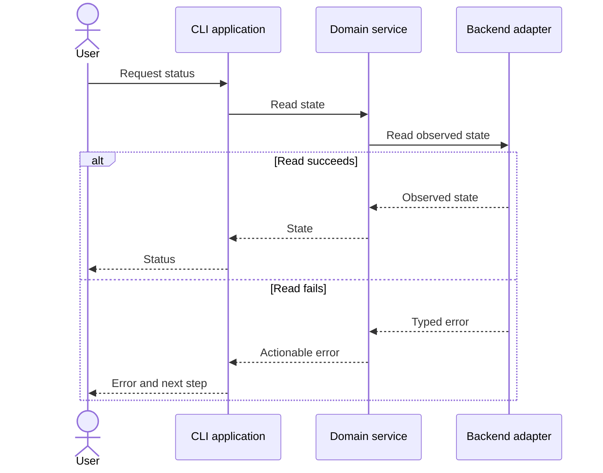
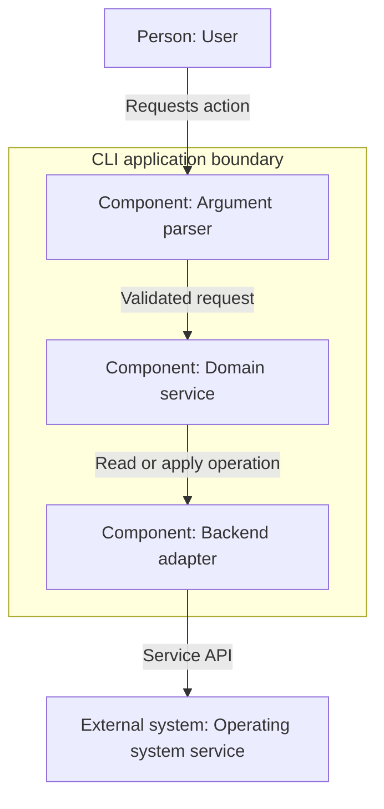

# Documentation patterns

These are illustrative patterns, not documentation for an implemented product.
Replace entities, commands, and behavior with verified project facts. The
[main skill](../SKILL.md) defines required layout and validation.

## README outline

Keep Getting Started before the standard sequence. Replace the guidance in this
outline with useful prose; do not publish empty headings or placeholders.

```markdown
# Project name

## Getting Started
Minimal prerequisites, the shortest supported setup, one useful action,
and its expected result. Link to full installation and usage instructions.

## Overview
Purpose, audience, implemented capabilities, scope, and maturity.

## Installation
Canonical installation and platform limits; link to advanced guides.

## Usage
Common tasks and examples; link to full CLI/API reference.

## Development / Testing
Supported toolchain and basic build/test commands; link to detailed guidance.

## Contributing
Explain the actual process or link to CONTRIBUTING.md.

## License
Identify and link to the actual license, or state that none has been provided.
```

Advanced setup belongs in a guide, not a dozen competing quickstart paths.
For a pre-release project, be explicit about what users can and cannot run.

## Runtime/use-case view: sequence diagram

This example shows a status query with success and failure paths. Document real
participants and error semantics rather than copying the names uncritically.



The important conclusion is that user-visible output follows the backend
result; the application does not imply success when reading fails.

## Logical view: C4-style component diagram

This uses standard flowchart syntax rather than native Mermaid C4 extensions.
It shows one component level inside an application boundary, with a person and
an external system outside. A separate container view would show applications
and services instead of their internal modules.



The boundary identifies the application internals, and relationship labels
explain responsibility. This is a C4-style representation, not a claim of full
native C4 notation or a specific deployed architecture.

## Mermaid review checklist

- Diagram type matches the question: sequence for runtime, C4-style flowchart
  for logical/component structure.
- Entities and relationships agree with implemented behavior or are explicitly
  labeled as proposed.
- IDs are simple and stable; labels are quoted where punctuation needs it.
- Participant declarations, `alt`/`else`/`end`, and `subgraph`/`end` are balanced.
- Arrows, labels, fences, and selected syntax are supported by the target viewer.
- No inline HTML, theme overrides, custom colors, or decorative complexity.
- Every new/changed diagram has an actual compatible-parser/render result, or
  the missing validation is explicitly reported. Static review alone is not a
  passing Mermaid render check.
- A visual review, when available, checks readable labels, direction, boundaries,
  and useful information; text also explains the diagram's conclusion.
